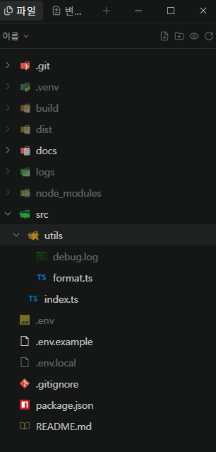

<div align="center">

# Git Ignore Fade

**Fade git-ignored files in Paseo's Files explorer — the way your editor does.**




</div>

## Why

`node_modules`, `dist`, `.venv`, `.env` — they sit right next to your source and look just as important. Git Ignore Fade dims everything git ignores, so the files you actually work on stand out.

## Install

```bash
paseo plugin add git:pax-d/paseo-git-ignore-fade
```

Requires Paseo **0.15.3+** and `git` on the daemon's `PATH`. No settings.

## How it works

| | |
|---|---|
| **Daemon** | Runs `git ls-files --others --ignored --exclude-standard --directory` in the open workspace. Respects `.gitignore`, `.git/info/exclude` and your global excludes. |
| **App** | Matches each explorer row to its path by name and indentation, then fades rows that are ignored or live inside an ignored folder. |
| **Refresh** | The list is re-fetched every 15 seconds, so new build output fades on its own. |

## Good to know

- **Desktop and web only.** Mobile is not supported.
- **Unknown rows stay normal.** If a row's path can't be worked out — for example a deep row whose parent folder is scrolled out of view — it is left alone rather than guessed.
- **Built on the explorer's markup.** Paseo has no explorer decoration API yet, so the plugin reads rows from the page. A Paseo update that changes that markup can break it. Last verified with **Paseo 0.15.3**.

## Development

```bash
npm install
npm run typecheck
node client/paths.check.mjs   # prints "ok"
```

## License

[MIT](LICENSE)
